# Splunk SIEM Setup & Universal Forwarder Deployment

A hands-on Security Information and Event Management (SIEM) lab demonstrating the deployment of **Splunk Enterprise** and the configuration of the **Splunk Universal Forwarder** on a Windows 11 endpoint for centralized Windows event log collection, monitoring, and security analysis.

[](https://www.splunk.com/)
[](https://www.microsoft.com/windows)
[](https://www.vmware.com/)
[](LICENSE)

---

## 📑 Table of Contents

- [Project Overview](#project-overview)
- [Lab Architecture](#lab-architecture)
- [Objectives](#objectives)
- [Lab Environment](#lab-environment)
- [Tools Used](#tools-used)
- [Project Implementation](#project-implementation)
  - [1. Downloading Splunk Enterprise](#1-downloading-splunk-enterprise)
  - [2. Installing Splunk Enterprise](#2-installing-splunk-enterprise)
  - [3. Configuring Splunk Receiving](#3-configuring-splunk-receiving)
  - [4. Downloading and Installing Splunk Universal Forwarder](#4-downloading-and-installing-splunk-universal-forwarder)
  - [5. Installing and Configuring Splunk Universal Forwarder](#5-installing-and-configuring-splunk-universal-forwarder)
  - [6. Verifying Forwarded Windows Logs in Splunk Enterprise](#6-verifying-forwarded-windows-logs-in-splunk-enterprise)
- [Forwarder Configuration Files](#forwarder-configuration-files)
- [Sample Splunk Queries (SPL) for Security Monitoring](#sample-splunk-queries-spl-for-security-monitoring)
- [Network & Firewall Troubleshooting](#network--firewall-troubleshooting)
- [Skills Earned](#skills-earned)
- [Key Learnings](#key-learnings)
- [Conclusion](#conclusion)

---

## 📖 Project Overview

This project focuses on deploying a **Security Information and Event Management (SIEM)** lab environment using **Splunk Enterprise** as the central data management and analytics engine and the **Splunk Universal Forwarder** as the lightweight endpoint log agent. Splunk Enterprise was deployed on a physical Windows host system, while a separate **Windows 11 virtual machine hosted in VMware Workstation** served as the target endpoint.

The Universal Forwarder was configured to collect critical Windows event logs—specifically **Application, Security, and System logs**—and stream them securely over TCP port **9997** to Splunk Enterprise. The successful ingestion and parsing of the endpoint host and event streams within Splunk Enterprise demonstrated an end-to-end telemetry pipeline suitable for SOC monitoring and threat detection.

---

## 🏗️ Lab Architecture

The lab environment separates the centralized SIEM ingestion/indexing tier from the endpoint log generation tier:

- **Windows Host System**: Acts as the central SIEM platform running **Splunk Enterprise** (Index, Search, Web interface, and Receiver).
- **Windows 11 VM (VMware Workstation)**: Acts as the monitored client endpoint running **Splunk Universal Forwarder**.
- **Data Pipeline**: Universal Forwarder collects local Windows Event Logs (`Wineventlog`) and sends them over TCP port `9997` to the Splunk Enterprise indexer.

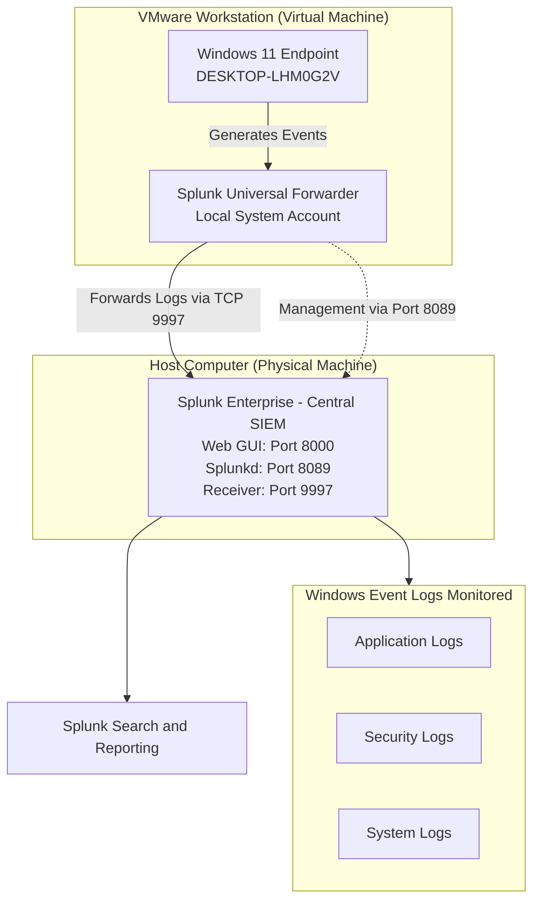

### 🌐 Lab Network Architecture (ASCII)

```text
                         HOST COMPUTER
                               │
               ┌───────────────┴───────────────┐
               │                               │
        Splunk Enterprise                  VMware
        Windows System                       │
               │                             ▼
               │                      Windows 11 VM
               │                             │
               │                    Splunk Universal
               │                       Forwarder
               │                             │
               │                             │
               ◄──────────── Port 9997 ──────┘
               │
               ▼
        Splunk Enterprise
           Central SIEM
               │
        ┌──────┼──────────┐
        │      │          │
        ▼      ▼          ▼
    Application Security System
       Logs      Logs      Logs
        │        │         │
        └────────┼─────────┘
                 ▼
         Splunk Search &
         Data Visualization
```

The **Splunk Universal Forwarder** on the Windows 11 VM collects **Application, Security, and System event logs** and forwards them to the **Splunk Enterprise server** over the configured receiving port **9997**.

---

## 🎯 Objectives

The primary objectives of this project were:

* Understand the core architecture and ingestion pipeline of a **SIEM platform**.
* Install and configure **Splunk Enterprise** as a centralized log management and analytics server.
* Install and configure the **Splunk Universal Forwarder** on an isolated Windows 11 endpoint.
* Configure Splunk Enterprise listening ports to receive remote forwarder traffic.
* Establish reliable network communication between the **Universal Forwarder and Splunk Enterprise**.
* Ingest and index **Windows Application, Security, and System event logs**.
* Verify event transmission and analyze received security data using **Splunk Search & Reporting**.

---

## 🖥️ Lab Environment

| Component | Configuration | Description |
| :--- | :--- | :--- |
| **SIEM Platform** | Splunk Enterprise | Central indexer, search head, and monitoring console |
| **Log Collection Agent** | Splunk Universal Forwarder | Lightweight data collection agent installed on endpoint |
| **Virtualization Platform** | VMware Workstation | Virtualization hypervisor hosting endpoint VM |
| **SIEM Server Host** | Windows Physical Host | Runs Splunk Enterprise |
| **Monitored Endpoint** | Windows 11 Pro VM | Generates endpoint security events (`DESKTOP-LHM0G2V`) |
| **Log Sources** | Windows Event Logs | Application, Security, and System channels |
| **Data Ingestion Port** | `9997` (TCP) | Default Splunk forwarder receiver port |
| **Management Port** | `8089` (TCP) | Splunkd REST API & deployment server communication |
| **Web UI Port** | `8000` (TCP) | Splunk Web console interface |

---

## 🛠️ Tools Used

* **Splunk Enterprise** – Central SIEM platform used for receiving, indexing, searching, and monitoring security events.
* **Splunk Universal Forwarder** – Purpose-built client agent used to harvest and forward Windows event logs.
* **VMware Workstation** – Hypervisor used to host the Windows 11 virtual machine.
* **Windows 11** – Monitored endpoint operating system generating event telemetry.
* **Windows Command Prompt / PowerShell** – Used for network validation (`ipconfig`, `Test-NetConnection`).
* **Splunk Web / Search & Reporting** – Interface used to verify hosts, inspect event sources, and execute SPL queries.

---

## ⚙️ Project Implementation

### 1. Downloading Splunk Enterprise

The first step in the SIEM lab setup was obtaining the official **Splunk Enterprise** installer.

#### Procedure

1. Navigate to the [official Splunk Enterprise download page](https://www.splunk.com/en_us/download/splunk-enterprise.html).
2. Select **Start Your Free Trial** and complete the account registration/verification.
3. Choose **Windows** as the target operating system (64-bit `.msi` package).
4. Download the installation package to the Windows host system designated as the SIEM server.

#### Purpose

This step provides the software installer for the central SIEM platform that will index, store, and analyze security telemetry.

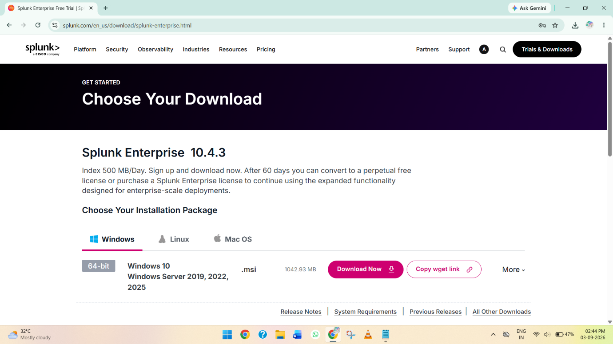

*Figure 1: Splunk Enterprise download page showing the Windows installation package.*

---

### 2. Installing Splunk Enterprise

The downloaded installer was executed to deploy Splunk Enterprise on the physical host machine.

#### Procedure

1. Navigate to the `Downloads` directory and launch the Splunk Enterprise installer.
2. Accept the software license agreement.
3. Select the installation path (default: `C:\Program Files\Splunk`).
4. Set up the primary **Splunk administrator credentials** (username and secure password).
5. Complete the installation wizard and click **Finish**.

#### Purpose

This deploys the central indexing service, the embedded web server (port 8000), and the background management service (`splunkd` on port 8089).

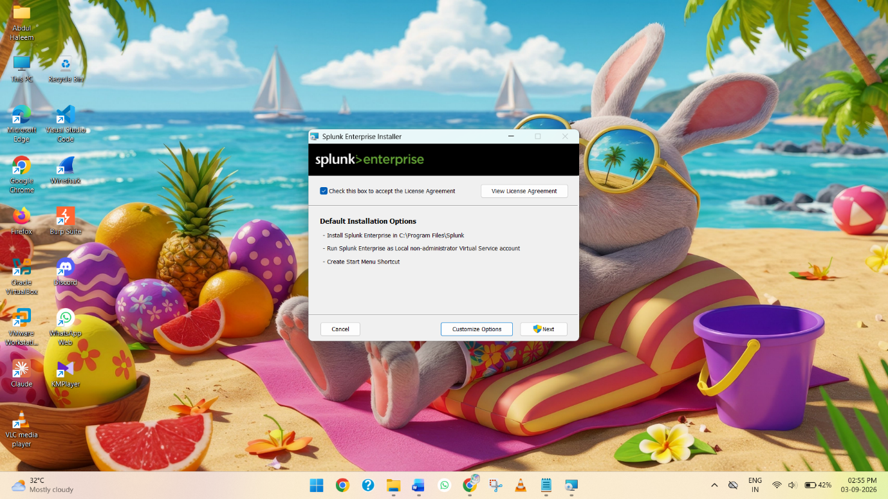

*Figure 2: Splunk Enterprise installation and configuration using the Setup Wizard.*

---

### 3. Configuring Splunk Receiving

Before the Universal Forwarder can stream data, Splunk Enterprise must be explicitly configured to listen for incoming forwarder traffic on a dedicated TCP receiving port.

#### Procedure

1. Log into the **Splunk Web Interface** (`http://localhost:8000`) using the administrative credentials.
2. In the top navigation bar, click **Settings**.
3. Under the **Data** category, select **Forwarding and receiving**.

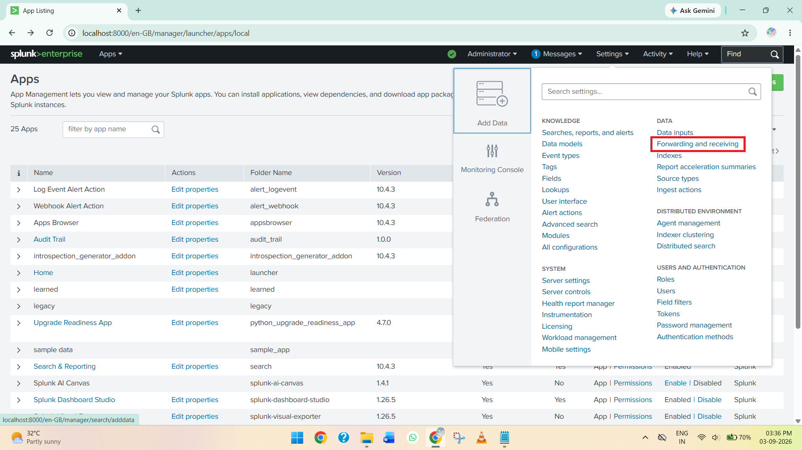

*Figure 3: Accessing the Forwarding and Receiving configuration under Splunk Settings.*

4. In the **Receive data** section, click **Add new** next to *Configure receiving*.

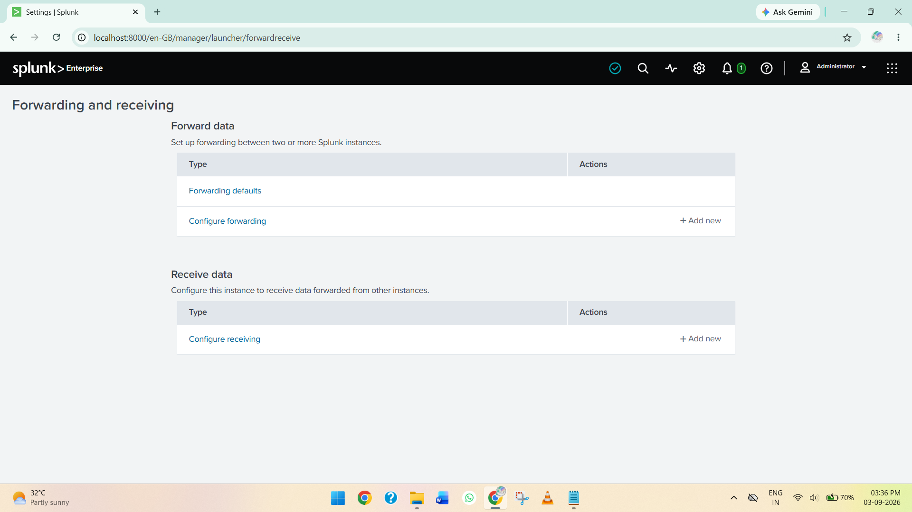

*Figure 4: Receive Data section in the Splunk Forwarding and Receiving configuration.*

5. Enter the standard Splunk receiver port: **9997**.

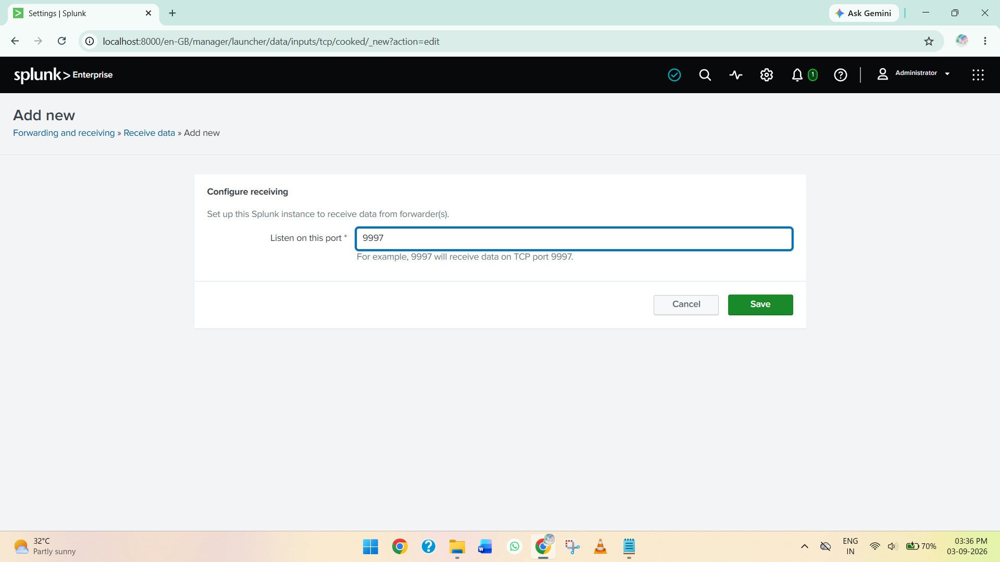

*Figure 5: Configuring Splunk Enterprise to receive forwarded data on port 9997.*

6. Save the configuration. Splunk Enterprise will now actively listen on TCP `9997`.

#### Purpose

Enables the TCP input pipeline on port `9997`, allowing Splunk Enterprise to parse, index, and categorize data forwarded from remote endpoints.

---

### 4. Downloading and Installing Splunk Universal Forwarder

A dedicated **Windows 11 virtual machine** was prepared inside **VMware Workstation** to serve as the log-generating endpoint.

#### Procedure

1. Boot the Windows 11 virtual machine within VMware Workstation.

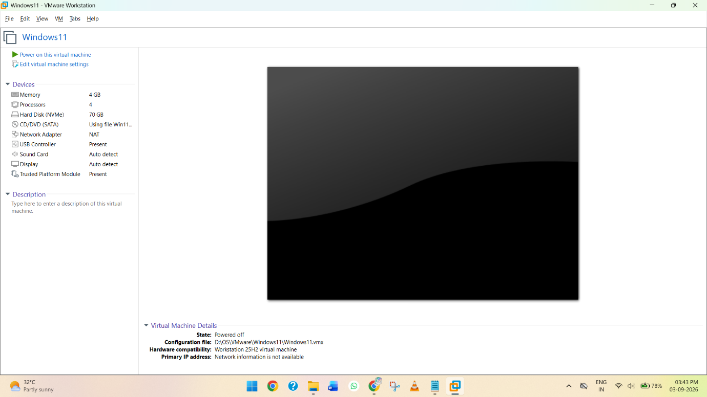

*Figure 6: Windows 11 virtual machine prepared for Splunk Universal Forwarder installation.*

2. Open a browser in the VM and navigate to the [official Splunk Universal Forwarder download page](https://www.splunk.com/en_us/download/universal-forwarder.html).
3. Select and download the **Windows 64-bit Universal Forwarder** installer.

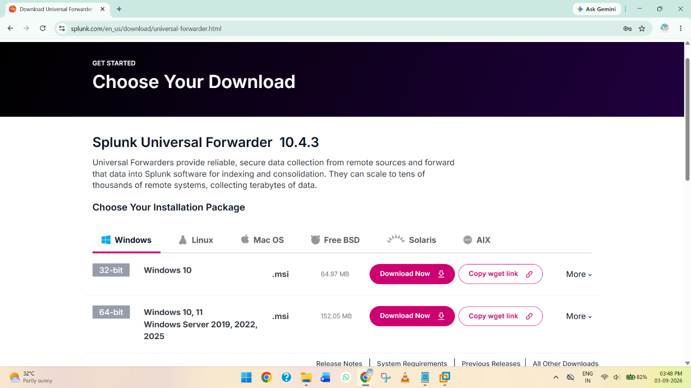

*Figure 7: Splunk Universal Forwarder page showing the Windows installation package.*

4. Locate the downloaded installer in the VM's `Downloads` directory.

#### Purpose

Deploys the lightweight agent on the target machine without the overhead of the full Splunk Enterprise suite.

---

### 5. Installing and Configuring Splunk Universal Forwarder

The Universal Forwarder was installed and configured to capture the necessary Windows event channels and point to the host SIEM indexer.

#### Procedure

1. Run the **Splunk Universal Forwarder** installer on the Windows 11 VM.
2. Accept the license agreement and click **Customize** for granular control over the configuration.


*Figure 8: Splunk Universal Forwarder installation screen showing the customization option.*

3. Set the service account to **Local System** to ensure the forwarder has sufficient permissions to read Windows Security event logs.


*Figure 9: Configuring the Splunk Universal Forwarder to run under the Local System account.*

4. Select the event log streams to capture:
   * **Application**
   * **Security**
   * **System**

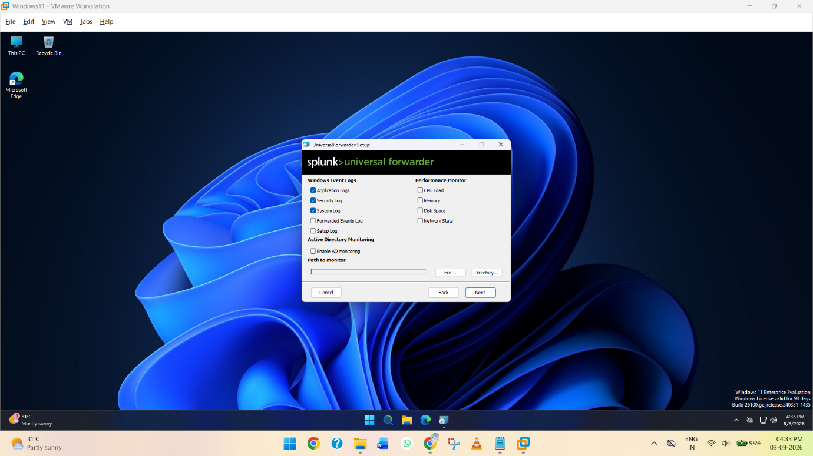

*Figure 10: Selecting Windows log sources to be monitored by the Splunk Universal Forwarder.*

5. Open **Command Prompt** on the **Splunk Enterprise Host** machine and run:
   ```cmd
   ipconfig
   ```
6. Identify the host's IPv4 address.

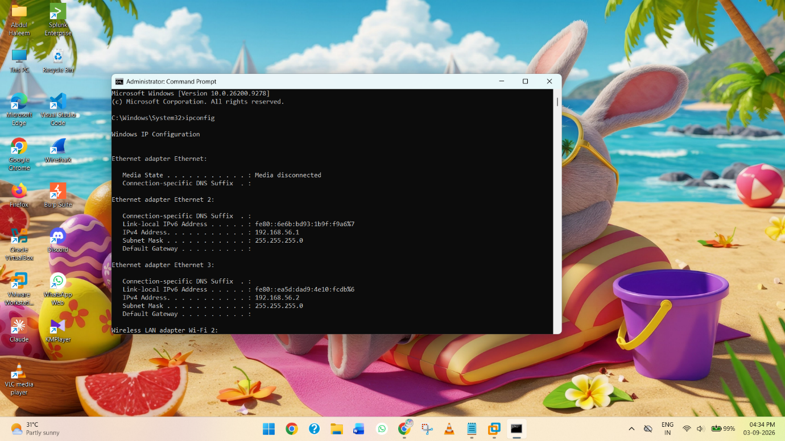

*Figure 11: Obtaining the Splunk Enterprise server IPv4 address using the `ipconfig` command.*

7. In the **Deployment Server** step of the installer, enter the host's IPv4 address and default port **8089**.


*Figure 12: Configuring the Deployment Server hostname/IP address and port 8089.*

8. In the **Receiving Indexer** step, enter the same host IPv4 address and the listening port **9997**.

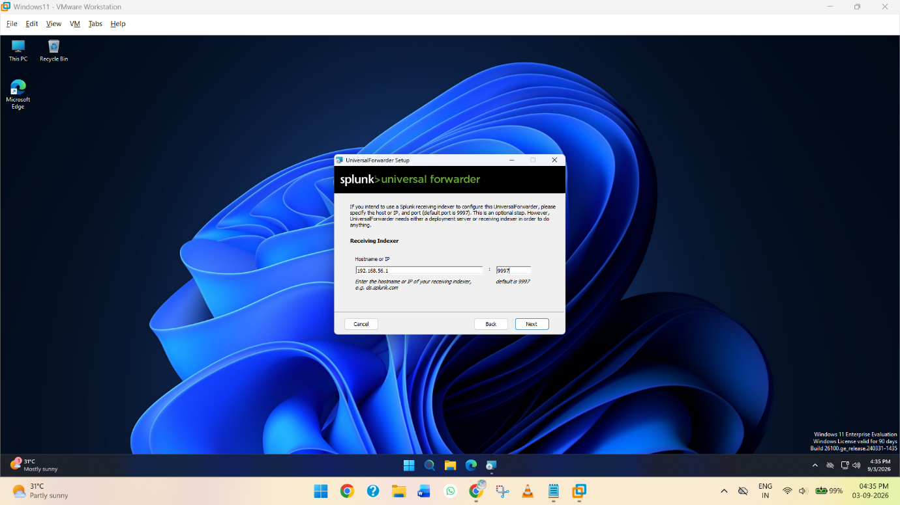

*Figure 13: Configuring the Receiving Indexer using the Splunk Enterprise server address and port 9997.*

9. Complete the installation. The Universal Forwarder service (`SplunkForwarder`) starts automatically.

#### Purpose

Establishes the forwarder's communication channels: management via port `8089` and active event data stream forwarding via port `9997`.

---

### 6. Verifying Forwarded Windows Logs in Splunk Enterprise

Once the agent was active, ingestion was verified within Splunk Enterprise.

#### Procedure

1. In Splunk Web, open the **Search & Reporting** app.
2. Click **Data Summary**.
3. Under the **Hosts** tab, verify that the forwarder host appears (in this lab: **`DESKTOP-LHM0G2V`**).

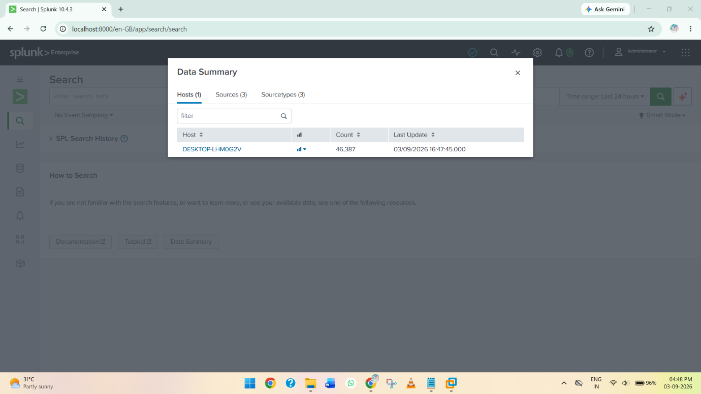

*Figure 14: Splunk Enterprise Data Summary showing the connected Windows host DESKTOP-LHM0G2V.*

4. Under the **Sources** tab, confirm that the three Windows event channels are actively populating:
   * `WinEventLog:Application`
   * `WinEventLog:Security`
   * `WinEventLog:System`

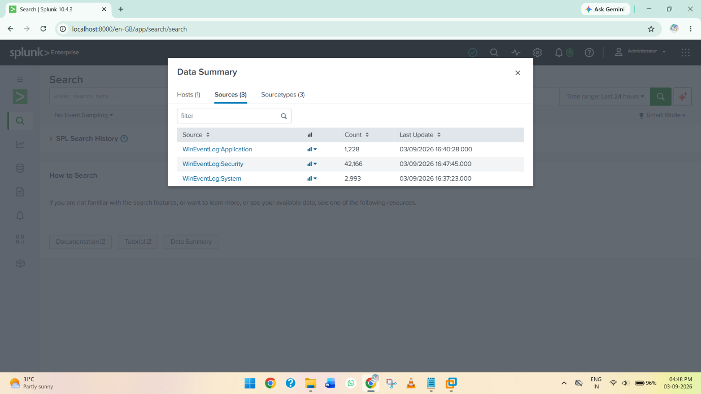

*Figure 15: Windows event log sources received by Splunk Enterprise.*

5. Click on any source or host to inspect raw ingested events, timestamps, and extracted fields in real time.

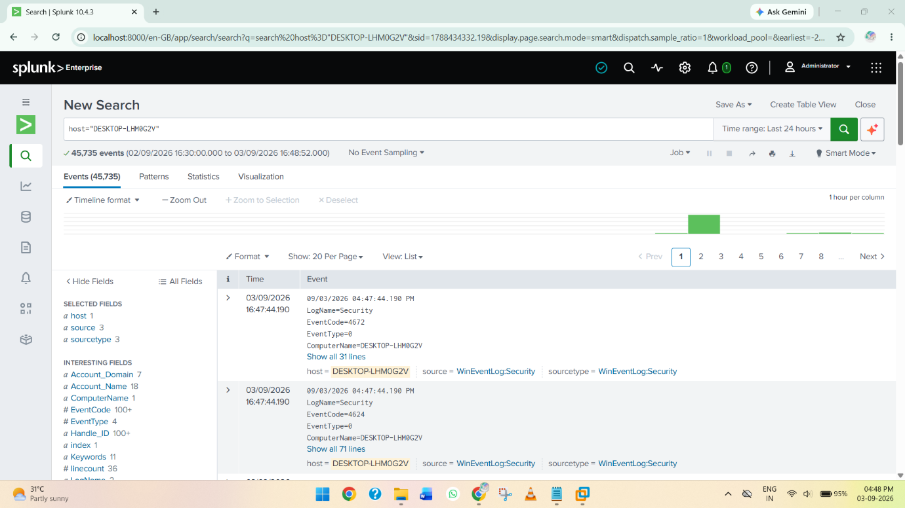

*Figure 16: Windows event logs received and displayed in Splunk Enterprise.*

#### Purpose

Validates that end-to-end network connectivity, port forwarding, authentication, and event indexing are functioning properly.

---

## 📄 Forwarder Configuration Files

While the GUI wizard configures the forwarder, in enterprise production environments configuration is managed via configuration files (`.conf`). Samples are included in the [`configs/`](configs/) directory of this repository:

### `inputs.conf` (`%SPLUNK_HOME%\etc\system\local\inputs.conf`)
Specifies which local logs the forwarder reads and streams:

```ini
[default]
host = DESKTOP-LHM0G2V

[WinEventLog://Application]
disabled = 0
index = main

[WinEventLog://Security]
disabled = 0
index = main

[WinEventLog://System]
disabled = 0
index = main
```

### `outputs.conf` (`%SPLUNK_HOME%\etc\system\local\outputs.conf`)
Specifies destination indexers and port targets:

```ini
[tcpout]
defaultGroup = default-autolb-group

[tcpout:default-autolb-group]
server = 192.168.1.50:9997
```

---

## 🔍 Sample Splunk Queries (SPL) for Security Monitoring

Once Windows event logs are ingested into Splunk, analysts can run searches to detect potential security incidents and suspicious endpoint activity:

### 1. Detect Failed Logon Attempts (Potential Brute Force / Password Spray)
*Windows Event ID 4625 indicates an account failed to log on.*
```spl
index=main sourcetype="WinEventLog:Security" EventCode=4625
| stats count by TargetUserName, WorkstationName, IpAddress, FailureReason
| sort - count
```

### 2. Identify Successful Logons & Logon Types
*Windows Event ID 4624 records successful authentications (e.g., LogonType 2 = Interactive, LogonType 10 = RDP).*
```spl
index=main sourcetype="WinEventLog:Security" EventCode=4624
| table _time, TargetUserName, LogonType, IpAddress, WorkstationName
| sort - _time
```

### 3. Track User Account Lockouts
*Windows Event ID 4740 is triggered when an account is locked out after repeated failed attempts.*
```spl
index=main sourcetype="WinEventLog:Security" EventCode=4740
| table _time, TargetUserName, Caller_Computer_Name
```

### 4. Monitor New Service Installations (Potential Persistence)
*Windows System Event ID 7045 indicates a new service was installed on the endpoint.*
```spl
index=main sourcetype="WinEventLog:System" EventCode=7045
| table _time, ServiceName, ServiceFileName, ServiceType, ServiceAccount
```

### 5. Review User Account Creation & Management
*Windows Event ID 4720 alerts whenever a new local or domain account is created.*
```spl
index=main sourcetype="WinEventLog:Security" (EventCode=4720 OR EventCode=4722 OR EventCode=4726)
| table _time, EventCode, TargetUserName, SubjectUserName
```

---

## 🛠️ Network & Firewall Troubleshooting

When deploying the Universal Forwarder in virtualized or segmented lab networks, connectivity issues are common. Here are key validation steps:

1. **Verify Inbound Receiver Port (Host SIEM)**:
   Ensure Windows Defender Firewall allows inbound TCP traffic on port `9997`. Run in PowerShell (Admin):
   ```powershell
   New-NetFirewallRule -DisplayName "Splunk Ingestion Port 9997" -Direction Inbound -LocalPort 9997 -Protocol TCP -Action Allow
   ```

2. **Test Port Connectivity from Endpoint VM**:
   From the Windows 11 virtual machine, test if port 9997 is reachable on the host:
   ```powershell
   Test-NetConnection -ComputerName <SPLUNK_ENTERPRISE_IP> -Port 9997
   ```
   *Expected output: `TcpTestSucceeded : True`*

3. **Check Splunk Forwarder Logs**:
   Inspect forwarder internal logs on the VM to debug connection drops:
   ```powershell
   Get-Content "C:\Program Files\SplunkUniversalForwarder\var\log\splunk\splunkd.log" -Tail 50
   ```

---

## 🧠 Skills Earned

* **SIEM Architecture & Administration**: Deploying and configuring Splunk Enterprise as a centralized monitoring system.
* **Endpoint Telemetry & Log Collection**: Installing and tuning Splunk Universal Forwarder agents on Windows endpoints.
* **Network & Port Ingestion Management**: Configuring TCP receiving channels (`9997`) and management listeners (`8089`).
* **Windows Event Log Analysis**: Ingesting and differentiating Application, Security, and System event streams.
* **SPL Query Crafting**: Writing Search Processing Language queries to detect authentication anomalies and system changes.
* **Firewall & Network Troubleshooting**: Diagnosing host-to-VM connectivity and verifying open service sockets.

---

## 🔑 Key Learnings

* **Centralized Visibility**: Forwarding raw endpoint telemetry to a centralized SIEM drastically reduces incident response time compared to reviewing local Windows Event Viewers.
* **Agent Architecture**: Splunk Universal Forwarder operates as a lightweight service with minimal CPU/RAM overhead, making it ideal for distributed endpoints.
* **Importance of Configuration Files**: While graphical installers are helpful for initial setups, understanding `inputs.conf` and `outputs.conf` is essential for scalable SOC operations.
* **Validation Methodology**: Verification using Splunk's **Data Summary** confirms not only host discovery but also event volume, source typing, and timestamp alignment.

---

## ✅ Conclusion

This project successfully established a working **SIEM pipeline using Splunk Enterprise and the Splunk Universal Forwarder**. By bridging a physical host SIEM server with a virtualized Windows 11 endpoint (`DESKTOP-LHM0G2V`), the lab verified full ingestion and indexing across Windows Application, Security, and System event streams.

The project demonstrates foundational knowledge essential for **SOC Analysts, Detection Engineers, and SIEM Administrators**, providing practical exposure to log forwarder deployment, network configurations, data verification, and event investigation.
